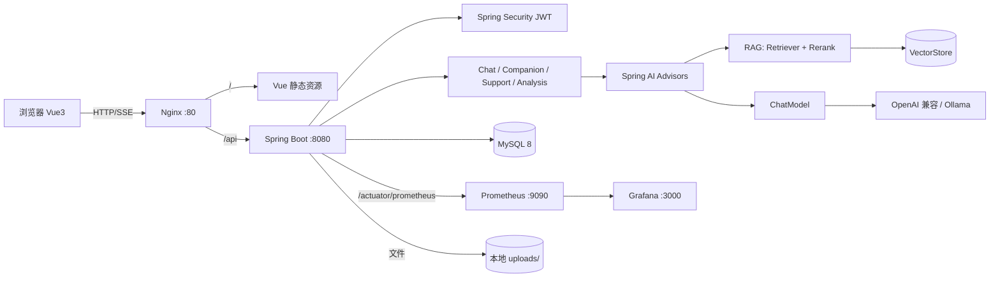

# AI App 前后端架构方案（v0.1）

> 目标：在一个仓库里，边学边做「AI 聊天 / AI 恋爱陪伴 / 智能客服 / 文档分析」四类能力，
> 后端基于 Spring Boot + Spring AI，前端 Vue 3，配套 MySQL、Nginx、Prometheus + Grafana。
> 本文是总体设计，不写死所有细节，后续按阶段迭代。
> 文档导航见 [INDEX](INDEX.md)，当前进度见 [STATUS](STATUS.md)，流式细节见 [modules/chat.md](modules/chat.md)，目标对标见 [04-对标](04-对标-yu-ai-agent.md)。
>
> ⚠️ **不要全文读**（约 357 行 / 6k tokens）。先读 §1「结论先行」，需要时再跳到 §3 架构 / §4 表结构 / §5 技术选型。

---

## 1. 结论先行

| 领域 | 选型 | 说明 |
| --- | --- | --- |
| JDK | **JDK 21 (LTS)** | 当前机器只有 JDK 8，**必须先装 21**；Spring Boot 3.x / Spring AI 最低 17 |
| 构建 | Maven 3.9.x | 当前 3.6.3 能跑，但建议升级；仓库自带 `mvnw` 后可不再依赖本机 Maven |
| 后端 | **Spring Boot 3.5.16** | 稳定线，教程/资料最多，与 Spring AI 1.1.x 匹配 |
| AI 框架 | **Spring AI 1.1.8** | 主框架；统一 Chat / Embedding / VectorStore / Advisor 抽象 |
| 备选 AI 框架 | LangChain4j 1.x | 不作为主框架；后续用独立 `ai-lab` 模块做对比学习 |
| ORM | MyBatis-Plus 3.5.17 | 分页、代码量少，SQL 可控，中文资料多 |
| 迁移 | Flyway | 建表脚本版本化，换电脑/协作可复现 |
| 数据库 | **MySQL 8.0.29（已有）** | 业务数据；向量检索先用文件版 SimpleVectorStore，后续可扩展 |
| 缓存/会话 | Redis（可选，后期） | 当前机器未装；一期用 MySQL 存会话记忆，跑通后再引入 |
| 前端 | **Vue 3.5 + TypeScript + Vite 7** | Composition API + `<script setup>` |
| UI | Element Plus + 自研聊天组件 | 后台管理类页面用 Element Plus，聊天区自定义 |
| 状态/路由 | Pinia 3 + Vue Router 4 | |
| 流式 | **SSE 默认 + WebSocket 对照** | SSE 用 fetch + ReadableStream；WS 用于双向场景，见 ADR-0002 |
| 鉴权 | Spring Security + JWT | 单机学习项目，先用户名密码，后续可加 OAuth |
| 接口文档 | springdoc-openapi (Swagger UI) | `/swagger-ui.html` |
| 可观测 | Actuator + Micrometer + Prometheus + Grafana | 指标、调用量、Token、时延 |
| 反向代理 | Nginx（Windows 版） | 静态资源 + `/api` 转发 + SSE 关闭缓冲 |
| 容器 | 暂无 Docker | 先用 Windows 原生包，后期再补 `docker-compose.yml` |

**一句话架构**：浏览器 → Nginx（可选）→ Vue 静态资源 / Spring Boot API → Spring AI →（云端或 Ollama 模型）
→ MySQL（业务数据 + 会话记忆）；文档经 ETL 入向量库；Micrometer 暴露指标给 Prometheus，Grafana 展示。

---

## 2. 当前环境盘点与待办

已确认：

- `D:\AI_learn` 为空目录，尚未初始化 Git。
- Git 2.20.1（偏旧），访问 GitHub 时报 `SSL_ERROR_SYSCALL 10054`，需要代理 / 升级 Git / 改用 SSH。
- Java 1.8.0_261（**不满足**），`JAVA_HOME=D:\JDK1.8`。
- Maven 3.6.3（可用但建议 3.9.x）。
- Node v24.18.0 / npm 12.0.2（满足 Vite 7）。
- MySQL 客户端 8.0.29 已安装，但**服务未启动**（未发现 3306 监听）。
- 未安装 Docker。

开工前必须完成：

1. 安装 **JDK 21**（Temurin / Microsoft OpenJDK 均可），配置 `JAVA_HOME`，IDEA 里切换 SDK。
2. 升级 **Git ≥ 2.40**，解决 GitHub 连通性（公司网络/代理则配置 `git config --global http.proxy`）。
3. 启动 MySQL，创建库 `ai_app` 与专用账号（不要用 root 跑应用）。
4. 安装 Nginx / Prometheus / Grafana 的 Windows 版（解压即用，放到 `infra/` 之外的本地工具目录，不提交二进制）。
5. 安装 Ollama（可选，本地模型）或准备一个 OpenAI 兼容的云端 Key（DeepSeek / 通义 / 豆包 / OpenAI）。

> 密钥只放环境变量或 `application-local.yml`（已 gitignore），**绝不提交仓库**。

---

## 3. 总体架构



### 3.1 分层

```
Controller  →  Application Service  →  Domain/Port  →  Adapter
   DTO           编排、事务、鉴权         接口定义         Spring AI / MyBatis / 文件
```

- Controller 只做参数校验与响应封装，不写业务。
- 所有模型调用走 `AiGateway`（自定义薄封装），避免业务代码直接依赖 Spring AI 具体类，
  以后替换 LangChain4j 或加多模型路由时只改 Adapter。
- RAG 的“切分 / 检索 / 拼 Prompt”封装成独立组件，可单测。

---

## 4. 仓库结构（单体 + 分模块包）

```
AI_app/
├─ backend/                                  # Spring Boot 单体
│  ├─ pom.xml
│  ├─ mvnw / mvnw.cmd
│  └─ src/main/
│     ├─ java/com/tutuchacha/ai/
│     │  ├─ AiApplication.java
│     │  ├─ common/                          # Result、异常、TraceId、SSE 工具
│     │  ├─ config/                          # AI、Security、MyBatis、OpenAPI、Async
│     │  ├─ auth/                            # 登录注册、JWT
│     │  ├─ chat/                            # 通用聊天 + 会话 + 记忆
│     │  ├─ companion/                       # AI 恋爱：角色卡、亲密度、长期记忆
│     │  ├─ support/                         # 智能客服：知识库绑定、引用、转人工
│     │  ├─ knowledge/                       # 知识库、文档、ETL、检索
│     │  ├─ analysis/                        # 文档分析：摘要/问答/抽取
│     │  ├─ meta/                            # 模型配置、Prompt 模板、用量统计
│     │  └─ metrics/                         # 自定义 Micrometer 指标
│     └─ resources/
│        ├─ application.yml
│        ├─ application-local.yml            # 本地配置，gitignore
│        ├─ prompts/*.st                     # Prompt 模板
│        └─ db/migration/V1__init.sql        # Flyway
├─ frontend/                                 # Vue 3 + Vite
│  ├─ package.json / vite.config.ts / tsconfig.json
│  └─ src/
│     ├─ api/                                # 按模块封装的请求
│     ├─ components/chat/                    # 消息气泡、输入框、引用卡片
│     ├─ composables/useSseChat.ts           # SSE 流式核心
│     ├─ layouts/
│     ├─ stores/                             # auth / conversation / settings
│     ├─ router/
│     ├─ views/                              # login, chat, companion, support, knowledge, analysis, dashboard
│     ├─ types/
│     └─ styles/
├─ infra/
│  ├─ nginx/nginx.conf
│  ├─ prometheus/prometheus.yml
│  ├─ grafana/dashboards/*.json
│  └─ scripts/                               # start-backend.ps1 / start-frontend.ps1 / start-all.ps1
├─ docs/
│  ├─ 00-架构方案.md
│  ├─ 01-环境准备.md
│  └─ 02-接口约定.md
├─ .env.example
├─ .gitignore
└─ README.md
```

> 不拆 Maven 多模块：学习阶段启动成本低，IDEA 直接 Run 即可。
> 包按业务垂直切分（package-by-feature），比按 Controller/Service/Mapper 横切更好维护。

---

## 5. 后端设计

### 5.1 核心依赖（版本以 BOM 锁定）

- `spring-boot-starter-web`、`validation`、`security`、`actuator`
- `spring-ai-starter-model-openai`（OpenAI 兼容协议，一套适配 DeepSeek / 通义 / Moonshot / Ollama）
- `spring-ai-advisors-vector-store`（QuestionAnswerAdvisor / RAG Advisor）
- `spring-ai-starter-model-chat-memory-repository-jdbc`（会话记忆落 MySQL）
- 文档解析：`spring-ai-tika-document-reader` / pdf / markdown reader
- `mybatis-plus-spring-boot3-starter` + `mybatis-plus-jsqlparser`（3.5.9+ 分页需单独引入）
- `flyway-core` + `flyway-mysql`、`mysql-connector-j`
- `micrometer-registry-prometheus`
- `springdoc-openapi-starter-webmvc-ui`
- `jjwt`（JWT）、`lombok`（可选）、`mapstruct`（可选）

### 5.2 模块与接口草案

统一前缀 `/api`，统一响应 `{ code, message, data, traceId }`；流式接口例外。

| 模块 | 接口 | 说明 |
| --- | --- | --- |
| 认证 | `POST /api/auth/register` `POST /api/auth/login` `GET /api/auth/me` | JWT |
| 会话 | `GET/POST /api/conversations` `GET /api/conversations/{id}/messages` `DELETE /api/conversations/{id}` | 按 `module` 区分 chat/companion/support |
| 聊天 | `POST /api/chat/stream` | SSE 流式，body 含 `conversationId/content/modelId/useRag/kbIds` |
| 聊天（WS） | `WS /ws/chat?token=` | M1.5 对照通道，帧协议见 `modules/chat.md` |
| 聊天 | `POST /api/chat` | 非流式，便于测试与降级 |
| 知识库 | `GET/POST/PUT/DELETE /api/knowledge-bases` | |
| 文档 | `POST /api/knowledge-bases/{id}/documents`（multipart） | 上传后异步解析 |
| 文档 | `GET /api/documents/{id}` `POST /api/documents/{id}/reindex` `DELETE /api/documents/{id}` | 状态：PENDING/PARSING/INDEXING/READY/FAILED |
| 检索 | `POST /api/knowledge-bases/{id}/search` | 检索测试，返回 chunk + score |
| 分析 | `POST /api/analysis/{documentId}/summary` `.../qa` `.../extract` | 结果落库 |
| 角色 | `GET/POST /api/personas` | 恋爱陪伴角色卡 |
| 反馈 | `POST /api/messages/{id}/feedback` | 点赞/点踩，喂后续评估 |
| 指标 | `GET /api/metrics/overview` | 应用侧汇总；系统指标走 Grafana |
| 运维 | `GET /actuator/health` `GET /actuator/prometheus` | |

### 5.3 流式事件协议（SSE / WS 共用载荷）

```text
event: meta      data: {"conversationId":"c1","messageId":"m1","model":"deepseek-chat"}
event: delta     data: {"content":"你"}
event: citation  data: {"documentId":"d1","chunkId":"k9","score":0.83,"title":"手册.pdf"}
event: usage     data: {"promptTokens":820,"completionTokens":96}
event: done      data: {"finishReason":"stop","latencyMs":1530}
event: error     data: {"code":"LLM_TIMEOUT","message":"模型超时"}
```

- `Content-Type: text/event-stream`，`Cache-Control: no-cache`，`X-Accel-Buffering: no`。
- 客户端断开时取消上游模型调用（`Flux` 取消 / `AbortController`）。
- 每个事件带序号或 `id`，为后续断线续传预留。
- WebSocket 通道把同样的 `data` 包成 `{"type":"delta",...}` 帧，业务层不感知传输差异。

### 5.4 RAG 流程

**入库（离线）**

```
上传 → 校验类型/大小/去重(sha256) → Tika 解析 → 清洗
     → TokenTextSplitter(chunk=800, overlap=120) → Embedding(batch)
     → VectorStore.add(documents) → 写 document_chunk / 状态 READY
```

**问答（在线）**

```
用户问题 → (可选)查询改写 → 向量检索 topK=6 → 相似度阈值过滤
        → (可选)重排 → 组装上下文 + 引用编号 → ChatClient 流式生成
        → 保存消息、引用、token 用量 → 返回 citation 事件
```

要点：

- 每个知识库记录 `embeddingModel`，换模型必须重建索引。
- 文档删除时同步删除向量（`VectorStore.delete(filter)`）。
- Prompt 里明确“只依据上下文回答；无依据时说明不知道”，降低幻觉。
- 评测：先做 20 条固定问题 + 人工打分，后续再引入自动化评估。

### 5.5 向量库方案（无 Docker）

| 阶段 | 方案 | 优缺点 |
| --- | --- | --- |
| 一期 | **SimpleVectorStore + 本地 JSON 持久化** | 零依赖、易调试；数据量大时慢 |
| 二期（推荐学习） | 自研 `MysqlVectorStore implements VectorStore` | 复用现有 MySQL，练手向量检索原理；10 万 chunk 内可接受 |
| 三期 | Qdrant / Elasticsearch / pgvector | 需要 Docker 或额外服务，性能最好 |

> MySQL 8.0.29 没有原生 VECTOR 类型，所以二期用 `JSON/BLOB` 存向量、Java 侧算余弦相似度，
> 并配 `kb_id` 过滤。仅作为学习/小规模方案，生产请换专用向量库。

### 5.6 会话记忆

- 短期：最近 N 轮消息（默认 20 条，按 token 截断）。
- 长期（恋爱陪伴）：`conversation_memory` 表存“事实/偏好/事件”，每轮异步抽取，检索后注入 System Prompt。
- Spring AI 的 `ChatMemory` + JDBC Repository 管理短期记忆；长期记忆自己实现，便于理解原理。

### 5.7 数据库设计（核心表）

| 表 | 关键字段 |
| --- | --- |
| `sys_user` | id, username, password_hash, nickname, avatar, role, created_at |
| `ai_model` | id, name, provider, base_url, model_name, api_key_cipher, temperature, enabled |
| `persona` | id, user_id, name, avatar, system_prompt, traits_json, greeting, visibility |
| `conversation` | id, user_id, module(chat/companion/support), persona_id, kb_id, title, model_id, last_message_at |
| `message` | id, conversation_id, role, content, tokens_in, tokens_out, latency_ms, model, created_at |
| `conversation_memory` | id, conversation_id, mem_type(fact/preference/event), content, weight, last_hit_at |
| `knowledge_base` | id, user_id, name, description, embedding_model, chunk_size, chunk_overlap |
| `document` | id, kb_id, filename, ext, size, sha256, status, chunk_count, error_msg |
| `document_chunk` | id, document_id, kb_id, chunk_index, content, embedding(JSON), token_count, metadata_json |
| `analysis_result` | id, document_id, type(summary/qa/extract), question, result_json, created_at |
| `chat_feedback` | id, message_id, rating, comment, created_at |
| `usage_log` | id, user_id, module, model, prompt_tokens, completion_tokens, latency_ms, success, trace_id, created_at |
| `prompt_template` | id, code, name, content, variables_json, version, enabled |

索引：`conversation(user_id, module, last_message_at)`、`message(conversation_id, id)`、
`document_chunk(kb_id, document_id)`、`usage_log(created_at, model)`。
建表全部走 Flyway，禁止手工改库。

### 5.8 安全与成本

- JWT 无状态鉴权；密码 BCrypt；接口按角色控制。
- API Key 只存密文（AES-GCM，主密钥来自环境变量）或干脆只读环境变量。
- 上传白名单：pdf/docx/txt/md；限制 20MB；文件名重命名；解析隔离。
- 全局限流（Bucket4j 或 Nginx `limit_req`）+ 单用户每日 token 配额。
- Prompt 注入：RAG 上下文与用户输入分区标记；系统提示词不暴露；输出做敏感词/内容安全过滤。
- 日志脱敏：不打印完整 Prompt、Key、手机号。

---

## 6. 前端设计

### 6.1 页面

| 路由 | 页面 | 一期内容 |
| --- | --- | --- |
| `/login` | 登录/注册 | JWT 存储、路由守卫 |
| `/chat` | 通用聊天 | 会话列表、流式输出、停止生成、重新生成、Markdown + 代码高亮 |
| `/companion` | AI 恋爱陪伴 | 角色卡选择、人设、打招呼语、亲密度展示 |
| `/support` | 智能客服 | 绑定知识库、引用来源、常见问题、转人工占位 |
| `/knowledge` | 知识库管理 | 上传、解析状态轮询、切片预览、检索测试 |
| `/analysis` | 文档分析 | 上传、摘要、追问、字段抽取、结果导出 |
| `/dashboard` | 用量看板 | 调用次数、Token、平均时延、错误率（ECharts），Grafana 外链 |
| `/settings` | 设置 | 模型、Prompt 模板、个人资料 |

### 6.2 关键技术点

- **传输抽象** `ChatTransport`：`SseChatTransport` / `WsChatTransport` 实现同一接口，
  页面只依赖 `useChat()`；切换通道改配置，不改业务组件。
- **SSE 封装** `useSseChat`：`fetch` + `ReadableStream` + `TextDecoder`，按 `\n\n` 解析事件；
  支持 `AbortController` 停止；自动重连不做，重试由用户触发。
- **Markdown 渲染**：`markdown-it` + `highlight.js` + `DOMPurify`（防 XSS）。
- **状态**：Pinia 只存会话元数据与用户信息；消息流用局部状态 + 增量追加，避免整表重渲染。
- **虚拟滚动**：消息超过 200 条时启用（`vue-virtual-scroller` 或自研）。
- **开发代理**：Vite `server.proxy['/api'] → http://localhost:8080`，避免本地 CORS。
- **生产/联调**：Nginx 同源部署，`/api` 反代后端，SSE 关闭缓冲。

### 6.3 Nginx 关键配置

```nginx
server {
    listen       80;
    server_name  localhost;

    root   D:/AI_learn/frontend/dist;
    index  index.html;

    location / {
        try_files $uri $uri/ /index.html;      # history 路由
    }

    location /api/ {
        proxy_pass         http://127.0.0.1:8080;
        proxy_http_version 1.1;
        proxy_set_header   Host $host;
        proxy_set_header   X-Real-IP $remote_addr;
        proxy_set_header   Connection "";
        proxy_buffering    off;                # SSE 必须
        proxy_cache        off;
        proxy_read_timeout 300s;
        chunked_transfer_encoding on;
    }

    client_max_body_size 25m;                  # 文档上传
}
```

---

## 7. 可观测性

### 7.1 指标

- 内置：JVM、HTTP（`http_server_requests_seconds`）、HikariCP、Tomcat 线程。
- 自定义（Micrometer）：
  - `ai_chat_requests_total{module,model,status}`
  - `ai_chat_latency_seconds{model}`（Timer）
  - `ai_tokens_total{model,type=prompt|completion}`
  - `ai_rag_retrieval_hits` / `ai_rag_empty_results_total`
  - `ai_document_ingest_seconds{status}`
- 日志：MDC 注入 `traceId`，Response Header 回传 `X-Trace-Id`。

### 7.2 Prometheus

```yaml
global:
  scrape_interval: 10s
scrape_configs:
  - job_name: ai-app
    metrics_path: /actuator/prometheus
    static_configs:
      - targets: ["127.0.0.1:8080"]
```

### 7.3 Grafana

- 数据源：Prometheus。
- 大盘：QPS/错误率/延迟分位、Token 消耗、模型分布、RAG 命中率、JVM 内存。
- 大盘 JSON 放 `infra/grafana/dashboards/`，可导入复现。
- 本地启动：`grafana-server.exe --homepath ...`，默认 3000/admin。

> 注意：Windows 原生安装时，Nginx、Prometheus、Grafana 的可执行文件不要提交仓库，
> 只提交配置文件和启动脚本。

---

## 8. 分阶段路线图（目标版见 04 文档）

| 阶段 | 目标 | 主要产出 | 学到什么 |
| --- | --- | --- | --- |
| **M0 骨架** | 跑起来 | 前后端脚手架、登录、统一响应、Flyway、Swagger、Actuator | Spring Boot 3 / Vue 3 工程化、跨域、JWT |
| **M1 流式聊天** | 核心体验 | ChatClient、SSE、会话/消息表、Markdown 渲染、停止生成 | Spring AI ChatClient、Reactor Flux、SSE |
| **M2 RAG** | 知识问答 | 知识库 CRUD、上传解析、切分、Embedding、检索、引用 | ETL、向量检索、Prompt 工程 |
| **M3 文档分析** | 独立能力 | 摘要、追问、结构化抽取、异步任务与进度 | 长文本策略、异步、任务状态机 |
| **M4 场景化** | 产品化 | 恋爱角色卡 + 长期记忆；客服知识库绑定 + 转人工 | 记忆管理、多租户数据隔离、业务建模 |
| **M5 观测与部署** | 可运维 | 自定义指标、Prometheus/Grafana 大盘、Nginx 联调、压测 | Micrometer、可观测性、反向代理 |
| **M6 进阶** | 拔高 | 重排、查询改写、评估集、MySQL 向量库、限流与配额 | RAG 优化、评测、性能 |

每个阶段结束都做到：能本地启动、有接口文档、有最小测试、能提交一个可回滚的 commit。

---

## 9. 开发与启动方式

| 场景 | 命令 |
| --- | --- |
| 后端（IDEA） | Run `AiApplication`，Active profile `local` |
| 后端（命令行） | `cd backend && mvnw spring-boot:run -Dspring-boot.run.profiles=local` |
| 前端 | `cd frontend && npm install && npm run dev` → http://localhost:5173 |
| 联调（Nginx） | `npm run build` 后启动 Nginx → http://localhost |
| 测试 | `mvnw test` / `npm run test` / `npm run lint` |
| 指标 | 后端 `/actuator/prometheus` → Prometheus 9090 → Grafana 3000 |

端口约定：前端 5173（dev）/ 80（Nginx），后端 8080，MySQL 3306，Prometheus 9090，Grafana 3000。

---

## 10. 关键决策与待确认

1. **模型来源**：本地 Ollama（免费、可控、吃显存）还是云端 API（效果好、按量计费）？
   建议两者都接，通过 `ai_model` 表切换，开发默认 Ollama。
2. **向量库**：一期文件版 SimpleVectorStore 是否够用？是否愿意在二期自研 MySQL 向量库？
3. **恋爱陪伴的边界**：只做“角色扮演 + 记忆”，还是需要亲密度/剧情/多角色？
4. **客服形态**：只做“知识库问答”，还是要工单、人工接管、多渠道接入？
5. **是否需要多用户/多租户**：影响所有表的 `user_id` 隔离与配额设计。

---

## 11. 风险清单

| 风险 | 影响 | 对策 |
| --- | --- | --- |
| JDK 8 直接上 Spring Boot 3 | 无法启动 | 先装 JDK 21，IDE 与 `JAVA_HOME` 同步切换 |
| GitHub 网络不通 | 无法 push | 代理 / SSH / 换网络；本地先 commit |
| 无 Docker | 中间件部署麻烦 | 用 Windows 原生包；配置与二进制分离 |
| 模型 Key 泄漏 | 被盗刷 | 环境变量 + `.gitignore` + 提交前扫描 |
| 向量库选型反复 | 返工 | 先定义 `VectorStore` 端口，实现可替换 |
| RAG 效果差 | 体验差 | 固定评测集、调 chunk/阈值、加重排 |
| 流式被 Nginx 缓冲 | 前端“卡住后一次性输出” | `proxy_buffering off` + `X-Accel-Buffering: no` |

---

## 12. 下一步

见 [`STATUS.md`](STATUS.md)，此处不重复，避免过期。

---

## 13. 文档与进度规则

为避免文档膨胀、保证 20k 上下文可随时接手，采用四层结构：

| 文件 | 作用 | 规则 |
| --- | --- | --- |
| `STATUS.md` | 仪表盘 | 每步**重写**，≤ 60 行，只留当前状态 |
| `progress/YYYY-MM.md` | 流水账 | 只追加，单条 ≤ 8 行，按月分文件 |
| `adr/NNNN-*.md` | 决策记录 | 一页 ≤ 60 行，不修改旧 ADR |
| `modules/*.md` | 模块手册 | ≤ 200 行，超限拆分 |

开工阅读顺序、每一步的落盘要求、文档体积硬限制，统一写在根目录 **`AGENTS.md`**。
新会话只需：`STATUS.md` → `INDEX.md` → 本次相关模块文档，禁止全量扫描历史。

