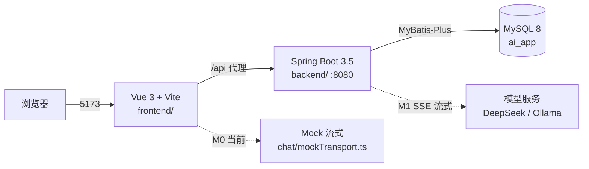
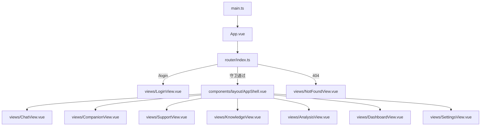
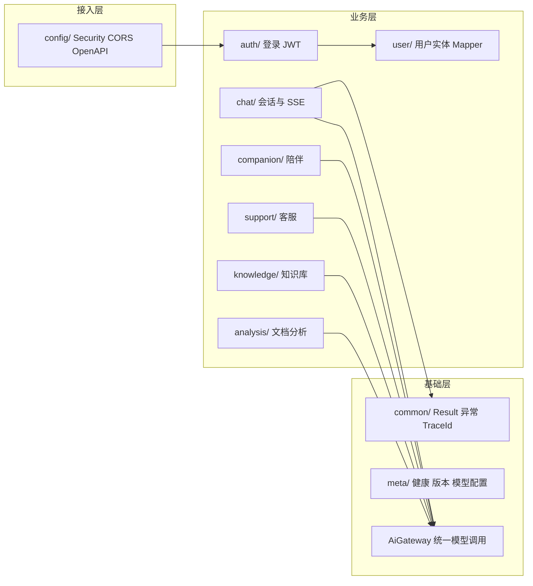
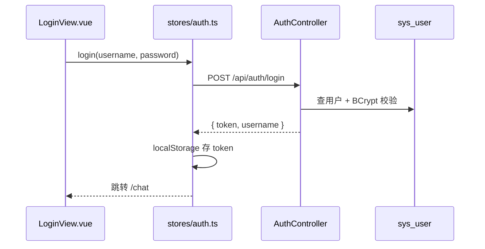
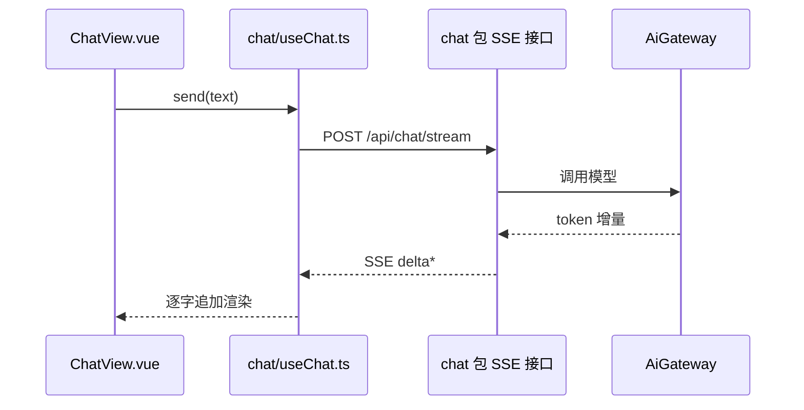

# 项目架构地图

> 目的：任何人在 3 分钟内找到「页面 → 文件」「功能 → 模块」。
> 图用 Mermaid 写，GitHub 直接渲染；VS Code 装 Markdown Preview Mermaid 插件也能看。

## 1. 一张总览

- 前端只认 `/api`，代理配置在 `frontend/vite.config.ts`
- 后端统一响应 `{ code, message, data, traceId }`，契约见 `docs/02-接口约定.md`
- 数据库只由 Flyway 改，见 `docs/modules/database.md`

## 2. 前端页面地图（谁在哪个文件）

| 路由 | 页面 | 文件 | 现状 |
| --- | --- | --- | --- |
| `/login` | 登录 | `frontend/src/views/LoginView.vue` | Mock 登录（B06 接真实接口） |
| `/chat` | 对话（首页） | `frontend/src/views/ChatView.vue` | 已用 Mock 流式 |
| `/companion` | 情绪陪伴 | `frontend/src/views/CompanionView.vue` | 角色选择 + Mock 对话 |
| `/support` | 智能客服 | `frontend/src/views/SupportView.vue` | 界面 + Mock |
| `/knowledge` | 知识库 | `frontend/src/views/KnowledgeView.vue` | 占位（M2） |
| `/analysis` | 文档分析 | `frontend/src/views/AnalysisView.vue` | 占位（M3） |
| `/dashboard` | 数据面板 | `frontend/src/views/DashboardView.vue` | 占位（M5） |
| `/settings` | 设置 | `frontend/src/views/SettingsView.vue` | 界面 |
| `/*` | 404 | `frontend/src/views/NotFoundView.vue` | 完成 |

## 3. 前端目录职责

| 路径 | 职责 | 改这里的时候 |
| --- | --- | --- |
| `src/main.ts` | 挂载 App、Pinia、Router、样式 | 加全局插件 |
| `src/App.vue` | 根组件，仅放 `<RouterView>` | 一般不动 |
| `src/router/index.ts` | 路由表 + 登录守卫 | 加页面、改权限 |
| `src/views/*.vue` | 一个文件 = 一个页面 | 改界面优先来这里 |
| `src/components/layout/AppShell.vue` | 侧边栏 + 顶栏 + 菜单 | 改导航 |
| `src/components/chat/*` | 消息列表/输入框/气泡 | 改聊天交互 |
| `src/components/LearningNote.vue` | 页面底部学习提示 | 加教学说明 |
| `src/chat/useChat.ts` | 发送、流式增量、停止、重置 | 接真实 SSE 时改 transport |
| `src/chat/mockTransport.ts` | 本地模拟流式输出 | M0 演示用，M1 保留开关 |
| `src/stores/auth.ts` | token / 用户名 / 登录登出 | B06 改为调后端 |
| `src/stores/ui.ts` | 侧边栏折叠等 UI 状态 | 纯前端状态 |
| `src/data/personas.ts` | 陪伴角色预设 | 加角色 |
| `src/types/chat.ts` | 消息、引用、传输层类型 | 改协议先改这里 |
| `src/styles/main.css` | 主题变量与全局样式 | 改配色/间距 |

## 4. 后端包结构（垂直切业务）

| 包 | 负责 | 关键文件（当前 → 规划） |
| --- | --- | --- |
| `com.tutuchacha.ai` | 启动类 | `AiApplication.java` |
| `config` | 安全、跨域、OpenAPI、JWT 配置 | ✅ `SecurityConfig`、`CorsConfig`、`JwtProperties`、`OpenApiConfig` |
| `common` | 统一返回、错误码、异常、TraceId | ✅ `Result`、`ErrorCode`、`BusinessException`、`GlobalExceptionHandler`、`TraceIdFilter` |
| `auth` | 注册、登录、JWT 过滤器 | ✅ `AuthController`、`AuthService`、`JwtService`、`JwtAuthFilter` |
| `user` | 用户实体与 Mapper | ✅ `User`、`UserMapper` |
| `meta` | 健康、版本、模型配置 | M1 起 |
| `chat` 等业务包 | 各业务垂直闭环 | M1–M5 逐步新增 |

规则：业务代码只依赖 `AiGateway`，不直接 import Spring AI 类；Controller 不写业务逻辑。

## 5. 关键链路

### 5.1 登录（后端 B04 已就绪，前端 B06 接入）

### 5.2 聊天流式（M1）

## 6. 相关文档

- 环境与启动：`docs/01-环境准备.md`、`docs/modules/backend.md` §4
- 前端细节：`docs/modules/frontend.md`
- 数据库与表结构：`docs/modules/database.md`
- 接口契约：`docs/02-接口约定.md`
- 文档怎么维护/改哪里同步哪里：[`DOC-GOVERNANCE.md`](DOC-GOVERNANCE.md)
- 当前进度与下一步：`docs/STATUS.md`
