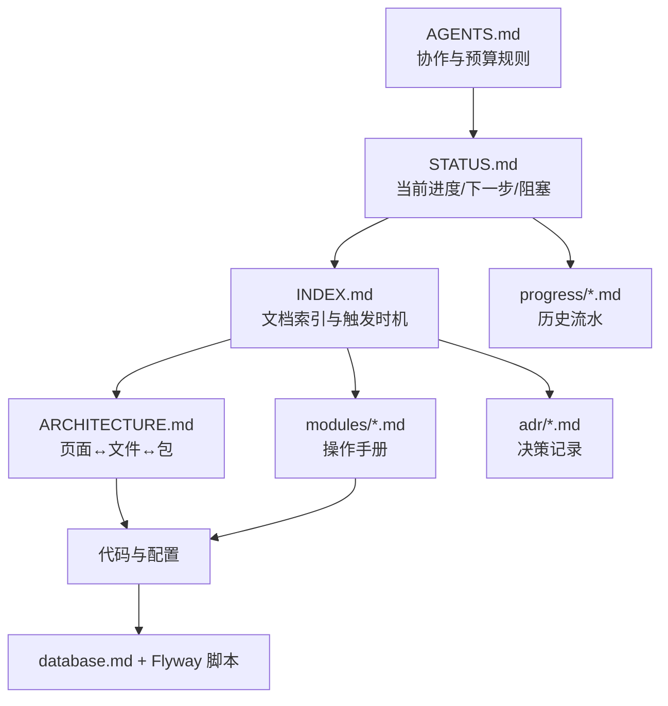

# 文档治理规则

> 解决四件事：谁是唯一事实来源、改代码要同步哪篇、每步收尾做什么、坏了怎么发现。
> 规则尽量少；靠 `scripts/doc-check.ps1` 自动兜底。

## 1. 分层与依赖



- 只向下引用：STATUS 不贴细节，INDEX 不写步骤，modules 不写历史。
- 同层不重复：同一事实只允许出现在一处，其它地方用路径链接。

## 2. 单一事实来源（SSOT）

| 事实 | 唯一来源 | 其他文档只做 |
| --- | --- | --- |
| 当前进度 / 下一步 / 阻塞 | `docs/STATUS.md` | 链接，不复述 |
| 表结构 / 索引 / 迁移规范 | `docs/modules/database.md` + `db/migration/*.sql` | 引用表名 |
| 页面 → 文件、包结构、链路 | `docs/ARCHITECTURE.md` | 引用路径 |
| 实施步骤 / 验收标准 | `docs/modules/*.md` | 引用章节号 |
| 历史流水 | `docs/progress/YYYY-MM.md` | 只追加，不改写 |
| 技术决策 | `docs/adr/NNNN-*.md` | 新 ADR 取代旧 ADR |
| 文档触发时机 | `docs/INDEX.md` | 不重复列表 |

## 3. 改代码时的同步清单

| 变更类型 | 同一次提交内必须更新 |
| --- | --- |
| 新增/修改表 | 新 Flyway 脚本 + `database.md` 表字典 + ER 图 |
| 新增/修改接口 | `docs/02-接口约定.md`（M0 定稿后）+ 对应 `modules/*.md` + `ARCHITECTURE.md` 链路 |
| 新增页面 / 路由 | `router/index.ts` + `ARCHITECTURE.md` §2/§3 + `modules/frontend.md` |
| 新增后端包 / 关键类 | `ARCHITECTURE.md` §4 + `modules/backend.md` §1 |
| 换技术 / 改流程 | 新 `adr/NNNN-*.md` + `INDEX.md` 登记（旧 ADR 不动） |
| 完成一步 | 重写 `STATUS.md` + 追加 `progress` 一条 + 运行检查脚本 |

## 4. 每一步收尾流程

1. 重写 `docs/STATUS.md`（≤30 行）：阶段、当前能力、下一步、限制。
2. 追加 `docs/progress/YYYY-MM.md`：结果、验证、下一步、commit，单条 ≤8 行。
3. 更新受影响的文档（见 §3 清单），新文档登记到 `INDEX.md`。
4. 跑 `pwsh scripts/doc-check.ps1`：预算 + 死链 + INDEX 覆盖，必须 0 失败。
5. 提交：`<阶段>-<序号> <动词>: <结果>`，push 后确认 HEAD 与远程一致。
   - progress 记录的是**功能提交**的短 hash；若功能提交里还没有该条流水，可另起一个 `docs: 回填流水` 提交补上，不算新步骤。

- 预算数值、提交信息格式、开工读法以 `AGENTS.md` §1–§3 为准，本文只补操作顺序，不复述数值。

## 5. 冲突处理

- 代码行为与文档冲突：以代码为准，但**同一次提交**修文档，禁止拖延。
- `database.md` 与迁移脚本冲突：以脚本为准，重跑 Flyway 后修文档。
- STATUS 与 modules 冲突：STATUS 代表“现在”，modules 代表“怎么做”；核对后改 STATUS。
- INDEX 与文件冲突：文件为准，补 INDEX 或删无用文档。

## 6. 自动化检查

```powershell
pwsh scripts/doc-check.ps1   # 行数/字符预算 + 本地链接 + INDEX 覆盖
```

- 新增文档未登记 INDEX、链接指向不存在的文件、超预算，都会返回非 0。
- 检查脚本本身也受版本管理；规则调整时先改本文档，再改脚本。
