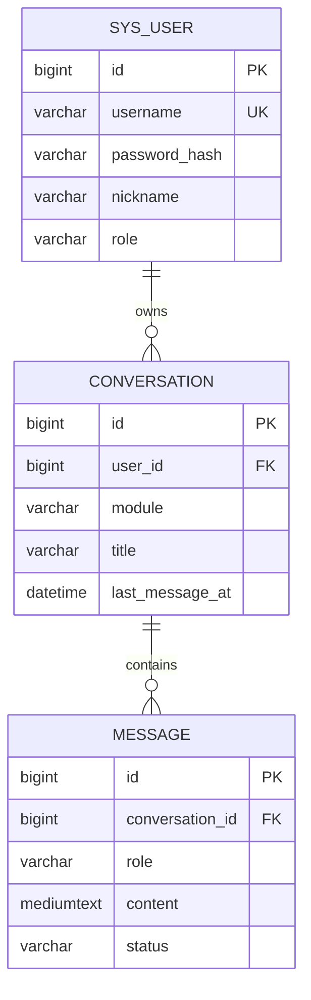

# 数据库手册（ai_app）

> 一份文档看懂：连哪个库、有哪些表、字段含义、怎么改表。
> 上限 120 行；表结构变更只走 Flyway，不改历史脚本。

## 0. 速览

- 实例：`127.0.0.1:3306`（本机 MySQL 8.0.29）
- 库：`ai_app`（utf8mb4 / utf8mb4_0900_ai_ci）
- 账号：`ai_app`；密码只写在 `backend/src/main/resources/application-local.yml`（gitignored）
- 迁移：`backend/src/main/resources/db/migration/`，启动时自动执行
- 当前表：`sys_user`、`conversation`、`message`、`knowledge_base`、`document`、`document_chunk`、`flyway_schema_history`
- 已执行版本：`V1 init` ~ `V5 chat citation`
- 其他项目的 `3307/pinliao` 与本项目无关，不要动

## 1. 表关系



M2 起加 `knowledge_base`（知识库）、`document`（文档）、`document_chunk`（切片）；M4 起加角色卡与记忆表。

## 2. sys_user（用户表）

| 字段 | 类型 | 允许空 | 默认/键 | 说明 |
| --- | --- | --- | --- | --- |
| id | bigint | 否 | PK, 自增 | 主键 |
| username | varchar(32) | 否 | UK `uk_user_username` | 登录名，唯一 |
| password_hash | varchar(100) | 否 | — | BCrypt 哈希，禁止存明文 |
| nickname | varchar(32) | 否 | 默认 `''` | 展示昵称 |
| role | varchar(16) | 否 | 默认 `USER` | `USER` / `ADMIN` |
| created_at | datetime | 否 | 默认当前时间 | 创建时间 |
| updated_at | datetime | 否 | 自动更新 | 更新时间 |

演示账号不写死在 SQL 里，由注册接口生成。

## 3. conversation（会话表，V2 + V3）

| 字段 | 类型 | 允许空 | 默认/键 | 说明 |
| --- | --- | --- | --- | --- |
| id | bigint | 否 | PK, 自增 | 主键 |
| uid | varchar(32) | 否 | UK `uk_conv_uid` | 对外会话 ID（`c_` 前缀），V3 新增 |
| user_id | bigint | 否 | FK → `sys_user.id` | 所属用户，删用户级联删会话 |
| module | varchar(16) | 否 | 默认 `chat` | `chat` / `companion` / `support` / `analysis` |
| persona_id | bigint | 是 | — | 角色卡 ID（M4 使用） |
| kb_id | bigint | 是 | — | 知识库 ID（M2 使用） |
| title | varchar(64) | 否 | 默认 `''` | 首条用户消息截断 30 字 |
| model_id | bigint | 是 | — | 模型 ID，M1-02 模型表接入前为空 |
| last_message_at | datetime | 是 | — | 最后消息时间，列表排序用 |
| created_at | datetime | 否 | 默认当前时间 | 创建时间 |
| updated_at | datetime | 否 | 自动更新 | 更新时间 |

索引：`idx_conv_user_module(user_id, module, last_message_at)`，按用户+模块倒序列会话；`uk_conv_uid(uid)` 保证对外 ID 唯一。

## 4. message（消息表，V2 + V5）

| 字段 | 类型 | 允许空 | 默认/键 | 说明 |
| --- | --- | --- | --- | --- |
| id | bigint | 否 | PK, 自增 | 主键 |
| conversation_id | bigint | 否 | FK → `conversation.id` | 所属会话，删会话级联删消息 |
| role | varchar(16) | 否 | — | `user` / `assistant` / `system` |
| content | mediumtext | 否 | — | 流式结束后写完整文本 |
| tokens_in | int | 否 | 默认 0 | 输入 token |
| tokens_out | int | 否 | 默认 0 | 输出 token |
| latency_ms | int | 否 | 默认 0 | 首字或整体耗时（毫秒） |
| model | varchar(64) | 否 | 默认 `''` | 实际模型名，如 `qwen-plus` |
| status | varchar(16) | 否 | 默认 `DONE` | `STREAMING` / `DONE` / `STOPPED` / `FAILED` |
| request_id | varchar(64) | 是 | — | 本次生成请求 ID，关联日志与重试 |
| citation_json | mediumtext | 是 | — | 引用片段 JSON 数组（V5），无引用为空 |
| created_at | datetime | 否 | 默认当前时间 | 创建时间 |

索引：`idx_msg_conv(conversation_id, id)`，顺序取会话消息。

## 5. 迁移规范

1. 命名 `V{序号}__{小写下划线描述}.sql`，序号递增、不复用（如 `V2__chat.sql`）。
2. 已执行的脚本禁止修改；改错就新增一版修正脚本。
3. 建表带 `ENGINE=InnoDB DEFAULT CHARSET=utf8mb4`，字段和表都写 `COMMENT`。
4. 不允许在 Navicat/命令行手改表；本地试验也先写脚本。
5. 写完启动一次后端，确认 `flyway_schema_history` 新增记录且 `success=1`。

## 6. 常用命令

```powershell
mysql --host=127.0.0.1 --port=3306 --user=ai_app -p ai_app
mysql ... ai_app -e "show tables; select version,description,success from flyway_schema_history;"
mysql ... ai_app -e "desc message; show index from message;"
mysqldump --host=127.0.0.1 --port=3306 --user=ai_app -p ai_app > backup.sql
```

## 7. 故障排查

| 现象 | 原因 | 处理 |
| --- | --- | --- |
| `Access denied` | 账号/库不对 | 用 root 重建账号并授权 `ai_app.*` |
| `Unknown database` | 库未建 | 见 `backend.md` §3 建库 |
| Flyway `validate failed` | 改了已执行脚本 | 还原脚本，新增修正版本 |
| 中文乱码 | 连接串缺 `characterEncoding=utf8` | 检查 `application-local.yml` |

## 8. 完成标准

- 后端启动无 Flyway 报错，`/actuator/health` = `UP`
- 表结构与本文档一致；新增表先改本文档再写迁移脚本
