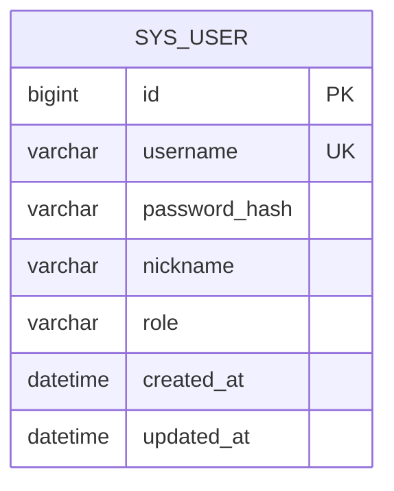

# 数据库手册（ai_app）

> 一份文档看懂：连哪个库、有哪些表、字段含义、怎么改表。
> 上限 120 行；表结构变更只走 Flyway，不改历史脚本。

## 0. 速览

- 实例：`127.0.0.1:3306`（本机 MySQL 8.0.29）
- 库：`ai_app`（utf8mb4 / utf8mb4_0900_ai_ci）
- 账号：`ai_app`；密码只写在 `backend/src/main/resources/application-local.yml`（gitignored）
- 迁移：`backend/src/main/resources/db/migration/`，启动时自动执行
- 当前表：`sys_user`、`flyway_schema_history`（Flyway 自维护）
- 其他项目的 `3307/pinliao` 与本项目无关，不要动

## 1. 表关系



M1 起逐步加入：`conversation`（会话）、`message`（消息）、`knowledge_doc`（文档）、`knowledge_chunk`（切片）。

## 2. sys_user（用户表）

| 字段 | 类型 | 允许空 | 键/默认 | 说明 |
| --- | --- | --- | --- | --- |
| id | bigint | 否 | PK, 自增 | 主键 |
| username | varchar(32) | 否 | UK `uk_user_username` | 登录名，唯一 |
| password_hash | varchar(100) | 否 | — | BCrypt 哈希，禁止存明文 |
| nickname | varchar(32) | 否 | 默认 `''` | 展示昵称 |
| role | varchar(16) | 否 | 默认 `USER` | `USER` / `ADMIN` |
| created_at | datetime | 否 | 默认当前时间 | 创建时间 |
| updated_at | datetime | 否 | 自动更新 | 更新时间 |

索引：`PRIMARY KEY(id)`、`UNIQUE KEY uk_user_username(username)`。
演示账号不写死在 SQL 里，由 B04 的注册接口生成。

## 3. 迁移规范

1. 新脚本命名 `V{序号}__{小写下划线描述}.sql`，例如 `V2__add_conversation.sql`，序号递增、不复用。
2. 已执行的脚本禁止修改；改错就新增一版修正脚本。
3. 建表必须带 `ENGINE=InnoDB DEFAULT CHARSET=utf8mb4`，字段和表都写 `COMMENT`。
4. 不允许在 Navicat/命令行手改表；本地想试验可先写脚本再执行。
5. 写完脚本启动一次后端，确认 `flyway_schema_history` 新增记录且 `success=1`。

## 4. 常用命令

```powershell
# 连接（回车后输入密码，见 application-local.yml）
mysql --host=127.0.0.1 --port=3306 --user=ai_app -p ai_app

# 看表与迁移记录
mysql --host=127.0.0.1 --port=3306 --user=ai_app -p ai_app `
  -e "show tables; select version, description, success from flyway_schema_history;"

# 看表结构
mysql --host=127.0.0.1 --port=3306 --user=ai_app -p ai_app -e "desc sys_user; show index from sys_user;"

# 备份 / 恢复
mysqldump --host=127.0.0.1 --port=3306 --user=ai_app -p ai_app > backup.sql
mysql --host=127.0.0.1 --port=3306 --user=ai_app -p ai_app < backup.sql
```

## 5. 故障排查

| 现象 | 原因 | 处理 |
| --- | --- | --- |
| `Access denied` | 账号/库不对 | 用 root 重建账号并授权 `ai_app.*` |
| `Unknown database` | 库未建 | `CREATE DATABASE ai_app ...`（见 backend.md §3） |
| Flyway `validate failed` | 改了已执行脚本 | 还原脚本，新增 V2 修正 |
| 中文乱码 | 连接串缺 `characterEncoding=utf8` | 检查 `application-local.yml` |

## 6. 建库建号（一次性，已执行）

```sql
CREATE DATABASE IF NOT EXISTS ai_app DEFAULT CHARACTER SET utf8mb4 COLLATE utf8mb4_0900_ai_ci;
CREATE USER IF NOT EXISTS 'ai_app'@'localhost' IDENTIFIED BY '<见本地配置>';
GRANT ALL PRIVILEGES ON ai_app.* TO 'ai_app'@'localhost';
FLUSH PRIVILEGES;
```

## 7. 完成标准

- 后端启动无 Flyway 报错，`/actuator/health` = `UP`
- 表结构与本文档一致；新增表先改本文档再写迁移脚本
