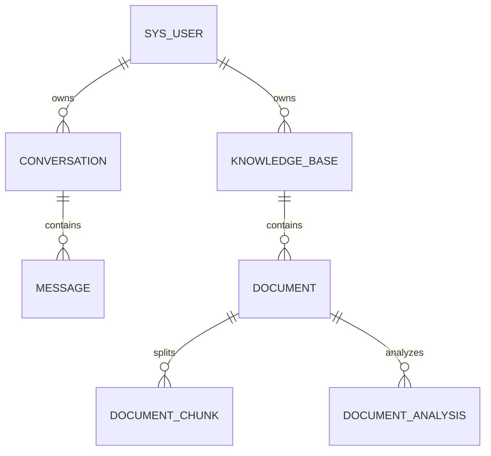

# 数据库手册（ai_app）

> 一份文档看懂：连哪个库、有哪些表、字段含义、怎么改表。
> 上限 120 行；表结构变更只走 Flyway，不改历史脚本。

## 0. 速览

- 实例：**CentOS VM `192.168.101.137:5432`**（Docker `pgvector/pgvector:pg16`，PG 16.15 + vector 0.8.7）
- 库：`ai_app`（UTF-8）；开发账号 `postgres`
- 密码只写在 `backend/src/main/resources/application-local.yml`（gitignored）；生产用 `DB_URL/DB_USERNAME/DB_PASSWORD`
- 迁移：`backend/src/main/resources/db/migration/`，启动时自动执行，当前 `V1 init` ~ `V7 analysis fields`
- 表：`sys_user`、`conversation`、`message`、`knowledge_base`、`document`、`document_chunk`、`document_analysis`、`flyway_schema_history`
- 主键：`BIGINT GENERATED BY DEFAULT AS IDENTITY`（MyBatis-Plus `IdType.AUTO` 不变）
- `updated_at`：PG 没有 `ON UPDATE CURRENT_TIMESTAMP`，统一用触发器函数 `set_updated_at()` 刷新
- 其他项目的 MySQL `3307/pinliao` 与本项目无关，不要动

## 1. 表关系



全部外键 `ON DELETE CASCADE`；删库时应用层额外把 `conversation.kb_id` 置空。

## 2. sys_user（用户表）

| 字段 | 类型 | 允许空 | 默认/键 | 说明 |
| --- | --- | --- | --- | --- |
| id | bigint | 否 | PK, identity | 主键 |
| username | varchar(32) | 否 | UK `uk_user_username` | 登录名，唯一 |
| password_hash | varchar(100) | 否 | — | BCrypt 哈希，禁止存明文 |
| nickname | varchar(32) | 否 | 默认 `''` | 展示昵称 |
| role | varchar(16) | 否 | 默认 `USER` | `USER` / `ADMIN` |
| created_at | timestamp | 否 | 默认当前时间 | 创建时间 |
| updated_at | timestamp | 否 | 默认当前时间 + 触发器 | 更新时间 |

演示账号不写死在 SQL 里，由注册接口生成。

## 3. conversation（会话表，V2 + V3）

| 字段 | 类型 | 允许空 | 默认/键 | 说明 |
| --- | --- | --- | --- | --- |
| id | bigint | 否 | PK, identity | 主键 |
| uid | varchar(32) | 否 | UK `uk_conv_uid` | 对外会话 ID（`c_` 前缀），V3 用 `md5(id-user_id)` 回填 |
| user_id | bigint | 否 | FK → `sys_user.id` | 所属用户 |
| module | varchar(16) | 否 | 默认 `chat` | `chat` / `companion` / `support` / `analysis` |
| persona_id / kb_id | bigint | 是 | — | 角色卡 / 知识库绑定 |
| title | varchar(64) | 否 | 默认 `''` | 首条用户消息截断 30 字 |
| model_id | bigint | 是 | — | 模型 ID，暂空 |
| last_message_at | timestamp | 是 | — | 最后消息时间，列表排序用 |
| created_at / updated_at | timestamp | 否 | 默认当前时间 | 创建 / 更新时间 |

索引：`idx_conv_user_module(user_id, module, last_message_at)`。

## 4. message（消息表，V2 + V5）

| 字段 | 类型 | 允许空 | 默认/键 | 说明 |
| --- | --- | --- | --- | --- |
| id | bigint | 否 | PK, identity | 主键 |
| conversation_id | bigint | 否 | FK → `conversation.id` | 删会话级联删消息 |
| role | varchar(16) | 否 | — | `user` / `assistant` / `system` |
| content | text | 否 | — | 流式结束后写完整文本 |
| tokens_in / tokens_out | int | 否 | 默认 0 | token 统计 |
| latency_ms | int | 否 | 默认 0 | 首字或整体耗时 |
| model | varchar(64) | 否 | 默认 `''` | 实际模型名，如 `qwen-plus` |
| status | varchar(16) | 否 | 默认 `DONE` | `STREAMING` / `DONE` / `STOPPED` / `FAILED` |
| request_id | varchar(64) | 是 | — | 关联日志与重试 |
| citation_json | text | 是 | — | 引用片段 JSON 数组（V5） |
| created_at | timestamp | 否 | 默认当前时间 | 创建时间 |

## 5. 向量列（V4，pgvector）

`document_chunk` 里有三列配合：

| 列 | 类型 | 说明 |
| --- | --- | --- |
| `embedding` | text | 向量 JSON 数组，写入代码只写这一列 |
| `embedding_vec` | `vector(1024)` 生成列 | `GENERATED ALWAYS AS (embedding::vector(1024)) STORED`，由 PG 自动转换 |
| `idx_chunk_vec` | HNSW 索引 | `vector_cosine_ops`，部分索引 `WHERE embedding_vec IS NOT NULL` |

- 检索：`ORDER BY embedding_vec <=> $1::vector LIMIT k`，`1 - 距离` 即余弦相似度
- 换 embedding 模型要改生成列的维度（`V8` 重建列 + 索引 + 重算向量）
- `metadata_json` 存 `text`（不是 jsonb），避免实体改 TypeHandler

## 6. 迁移规范

1. 命名 `V{序号}__{小写下划线描述}.sql`，序号递增、不复用。
2. 已执行的脚本禁止修改；改错就新增一版修正脚本。
3. 建表写 `GENERATED BY DEFAULT AS IDENTITY`；注释用 `COMMENT ON TABLE/COLUMN`。
4. 带 `updated_at` 的表要建 `BEFORE UPDATE` 触发器调 `set_updated_at()`。
5. 不允许在客户端手改表；本地试验也先写脚本。
6. 写完启动一次后端，确认 `flyway_schema_history` 新增记录且 `success = true`。

## 7. 常用命令

```powershell
# 直连 VM（Windows 需能访问 192.168.101.137:5432）
psql "host=192.168.101.137 port=5432 dbname=ai_app user=postgres"
# 或进容器（VM 上）
docker exec -it xingyu-vm-postgres-1 psql -U postgres -d ai_app
# 版本与索引
\dt
select version, description, success from flyway_schema_history order by installed_rank;
\d document_chunk
```

## 8. 故障排查

| 现象 | 原因 | 处理 |
| --- | --- | --- |
| `password authentication failed` | 账号或密码不对 | 改 `application-local.yml` 或 `DB_PASSWORD` |
| `relation "sys_user" does not exist`（Flyway V2 失败） | 库非空，`baseline-on-migrate` 把基线设成 V1 并跳过 V1 | `DROP SCHEMA public CASCADE; CREATE SCHEMA public;` 后重启 |
| `type "vector" does not exist` | 没装 pgvector 扩展 | 用 `pgvector/pgvector` 镜像，或 `CREATE EXTENSION vector` |
| `expected 1024 dimensions` | 向量模型换了维度 | 改生成列维度并重算向量 |
| Flyway `validate failed` | 改了已执行脚本 | 还原脚本，新增修正版本 |

## 9. 完成标准

- 后端启动无 Flyway 报错，`/actuator/health` = `UP`
- `select count(*) from document_chunk where embedding_vec is not null` 与 READY 切片数一致
- 表结构与本文档一致；新增表先改本文档再写迁移脚本
